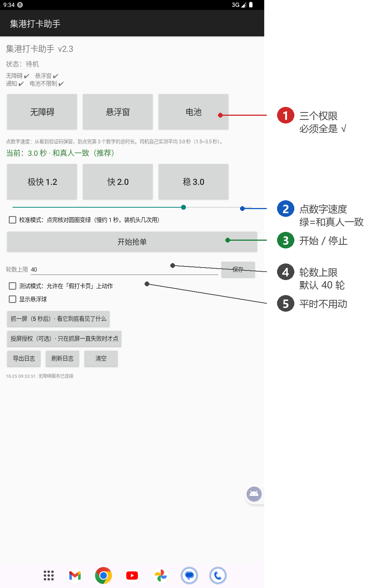
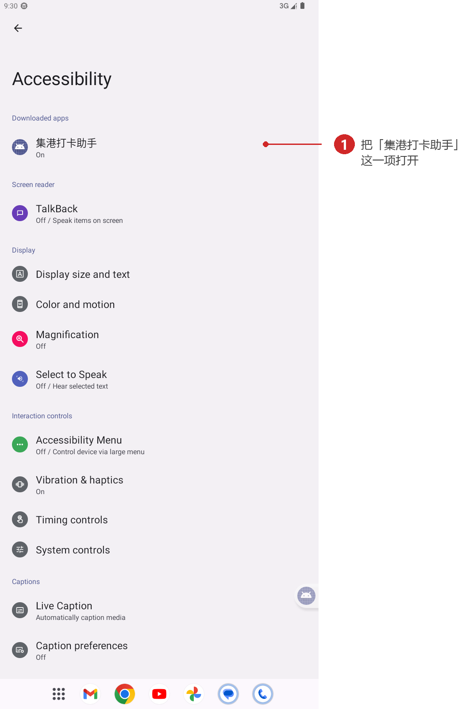
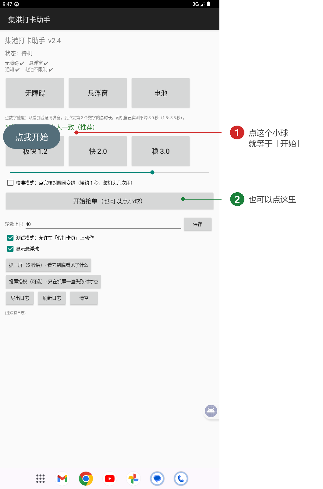
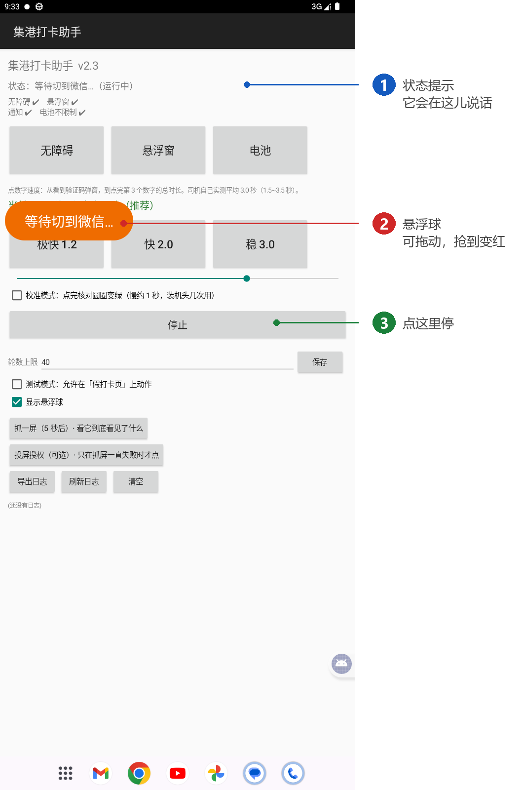
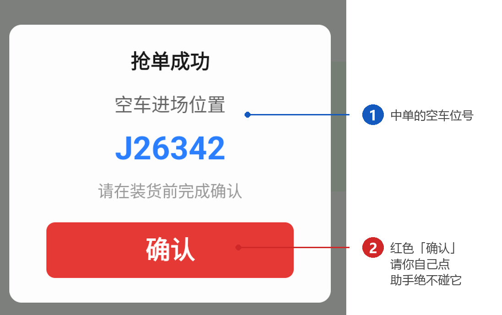

# 集港打卡助手 · 使用说明（v2.4）

---

## 一、开三个权限

装好打开，界面长这样：

**三个权限必须全是 √（图中 ①），缺一个就点它进去开。**

| 点这个按钮 | 进去做什么 |
|---|---|
| **无障碍** | 系统设置里找到「集港打卡助手」，把开关打开（见下图）。**这个不开，助手什么都做不了。** |
| **悬浮窗** | 允许「显示在其他应用上层」，不然看不到那个能拖的小球。 |
| **电池** | 允许后台运行／不受电池限制。vivo、荣耀这类机子不设它，跑几分钟会被系统杀掉。 |

打开无障碍的那一页长这样，把「集港打卡助手」这一项打开：

> 💡 每次更新安装包后，系统都会把无障碍关掉，界面上会出现红字提醒你重开——这不是坏，重开一次就行。

另外把 **「显示悬浮球」勾上**（图中 ⑤ 那一行下面），不然看不到小球。**「测试模式」别勾**，那是调试用的。

---

## 二、调速度

**「点数字速度」= 从看到验证码弹窗，到点完第 3 个数字的总时长**（图中 ②）。

| 按钮 | 总时长 | 适合谁 |
|---|---|---|
| 极快 | 1.2 秒 | 手快、想抢快一点 |
| **快（默认）** | **2.0 秒** | 大多数情况 |
| 稳 | 3.0 秒 | 和司机实测的真人节奏一致 |

也可以拖下面的滑条，0.5 ~ 4.0 秒任意调。**改完下一轮生效，不用停。**

- 颜色：**绿 = 和真人一致**，黄橙 = 偏快，红 = 太快
- 三个数字之间按 72:18:10 分配间隔（读题久、后两下快），每段有 ±12% 抖动，不像机器
- 想核对「点完格子有没有变绿」，勾上 **校准模式**，每轮会慢约 1 秒

---

## 三、开始抢单

**顺序：先开助手 → 再开打卡页 → 点小球开始。**（这样不用来回切）

1. 先打开助手（看到上面那页就行），**勾上「显示悬浮球」**，屏幕上会出现一个写着「点我开始」的小球
2. 再去微信打开「北斗集港服务」，停在能看到蓝色「集港打卡」按钮的那一页
3. **点那个小球**——它立刻开始干活（也可以回助手点「开始抢单（也可以点小球）」）

小球可以按住拖动，建议拖到不挡按钮的地方。状态提示会一直告诉你它在干什么：

- **小球颜色**：灰/橙 = 在跑，红 = 抢到了
- **停止**：随时点小球，立刻停手
- **开始后你还没打开打卡页也没关系**，它会等最多 5 分钟（状态写「等你打开微信打卡页…」），不会一开就停

**它的节奏**：点打卡 → 认验证码 → 按顺序点 3 下 → 等结果。没中就等 0.8 秒进下一轮；出现橙色感叹号就点左上角「‹」回打卡页继续。

---

## 四、抢到之后

助手会：**立刻停手** → 响铃 3 次 + 震动 → 小球变红 → 把空车进场位置复制进剪贴板 → 存一张截图到相册 `Pictures/集港助手/`。

然后：**① 看一眼车位号并记下来；② 红色「确认」你自己点。**

---

## 五、什么时候会自己停

| 情况 | 界面提示 |
|---|---|
| 抢到了 | 已抢到！请手动点确认 |
| 连续 20 轮没中 | 连续 20 轮没中 |
| 连续 5 次异常 | 连续 N 次异常 |
| 一直找不到「集港打卡」按钮 | 一直找不到「集港打卡」按钮 |
| 跑满你设的轮数（默认 40） | 跑够 N 轮 |
| 熄屏 / 切出微信太久 | 窗口不是微信 |

停了不会自己重开，你处理完再点「开始抢单」。

---

## 六、常见问题

**Q：打开就是红字「无障碍没开」？**
点上面那个「无障碍」按钮，进系统设置把「集港打卡助手」打开，回来那行会变成 √。每次重装 APK 都要做一次。

**Q：一直显示「等你打开微信打卡页…」？**
它就是在等你把打卡页打开（最多等 5 分钟）。微信切到前台、进「北斗集港服务」那一页就行，不用再回助手点一次。

**Q：它写着「不在微信」，还自己停了？**
说明开始之后它已经跑过轮次了，这时切走会被当成异常，20 秒左右就停。重新点小球开始即可。

**Q：一直「找不到集港打卡按钮」？**
页面没加载出来或滚动位置不对。手动把按钮露出来再点开始。

**Q：日志怎么看？**
界面上直接能看。想导出来点「导出日志」，文件在 `Download/集港助手/日志.txt`；想给我截图，点「抓一屏」，图会存到相册。

**Q：抢到的截图在哪？**
相册 `Pictures/集港助手/`。

---

*版本 v2.4 · 2026-10-25*
